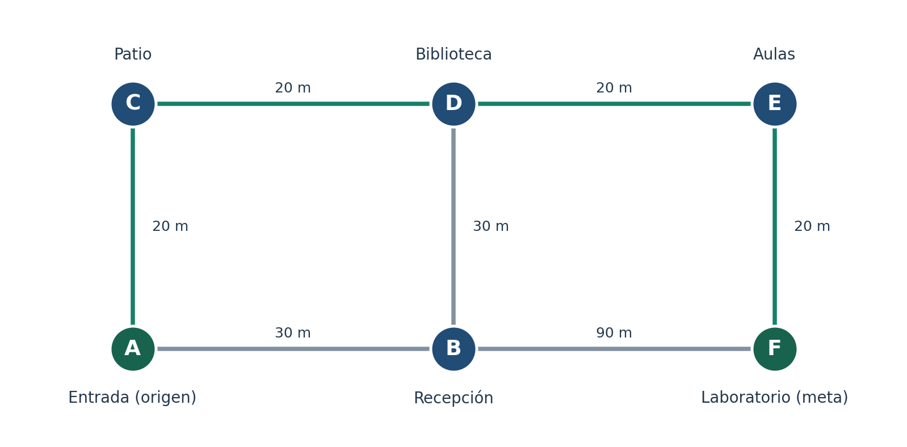

# Actividad 3. Modelado del problema mediante grafos

**Responsable:** Johann Condor Vargas | Curso 30710

## 3.1. Representación del campus

Se propone un grafo no dirigido y ponderado G = (V, E). Cada nodo representa una ubicación del campus; cada arista, un camino peatonal que puede recorrerse en ambos sentidos. Los pesos indican la distancia estimada en metros. El origen es A (Entrada) y el destino es F (Laboratorio). Los lugares y las distancias son ficticios, definidos para demostrar los algoritmos.

**Nodos:** A: Entrada, B: Recepción, C: Patio, D: Biblioteca, E: Aulas, F: Laboratorio.

**Aristas (bidireccionales):** A–B: 30 m, B–F: 90 m, A–C: 20 m, C–D: 20 m, D–E: 20 m, E–F: 20 m, B–D: 30 m.

Las aristas verdes muestran la ruta óptima por distancia.

## 3.2. Búsqueda en profundidad (DFS)

Conviene utilizar DFS cuando se desea explorar pasillos y comprobar si existe un camino hacia el laboratorio, por ejemplo, al investigar rutas alternativas durante un cierre. Avanza por una rama hasta que encuentra el destino o no puede continuar; entonces retrocede. Se puede implementar con recursividad y un conjunto de nodos visitados para evitar ciclos. Con vecinos en orden alfabético, explora A, B, D, C (retrocede), E y F; devuelve A → B → D → E → F, con 100 m. No garantiza la ruta más corta.

## 3.3. Búsqueda en anchura (BFS)

Conviene utilizar BFS cuando el estudiante desea llegar al laboratorio atravesando la menor cantidad de conexiones, sin considerar sus distancias. Utiliza una cola FIFO y explora los vecinos por niveles. En el ejemplo encuentra A → B → F, con dos conexiones y 120 m. Garantiza el mínimo número de aristas en un grafo sin pesos o cuando todos los pesos son iguales, pero no la distancia mínima si los pesos son diferentes.

## 3.4. Algoritmo heurístico A*

A* permite orientar la búsqueda hacia una meta y considerar el costo real del recorrido. Utiliza f(n) = g(n) + h(n), donde g(n) es la distancia acumulada desde el origen y h(n) estima la distancia restante. Se elige el nodo pendiente con menor f(n). En este ejemplo, h es la distancia Manhattan a F sobre una cuadrícula ideal de 20 m por lado; no sobreestima porque cada arista cuesta al menos el desplazamiento correspondiente. Sus valores para A, B, C, D, E y F son 40, 20, 60, 40, 20 y 0 m. Al llegar a B por A, f = 30 + 20 = 50; al llegar a C, f = 20 + 60 = 80. A* explora B primero, pero después encuentra la ruta A → C → D → E → F, de 80 m. Con costos no negativos y una heurística admisible, esta implementación obtiene una ruta de costo mínimo.

## Comparación de resultados

| Algoritmo | Ruta | Conexiones | Distancia |
|---|---|---:|---:|
| DFS | A → B → D → E → F | 4 | 100 m |
| BFS | A → B → F | 2 | 120 m |
| A* | A → C → D → E → F | 4 | 80 m |

DFS sirve para explorar; BFS minimiza conexiones; A* minimiza distancia en el ejemplo.

## Ejecución en Java

Requiere JDK 17 o posterior. Ejecutar `javac Actividad3.java` y `java Actividad3` desde esta carpeta. Los resultados se reproducen en consola.

Base de la actividad: PA4 – Evaluación aplicada sobre recursividad y grafos, curso 30710, p. 2.
